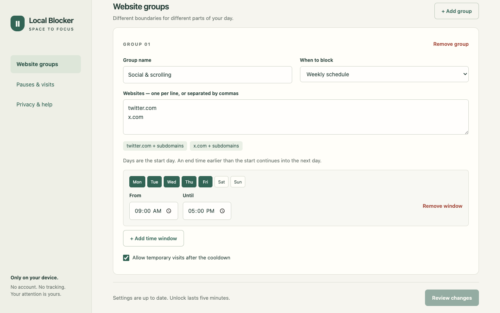
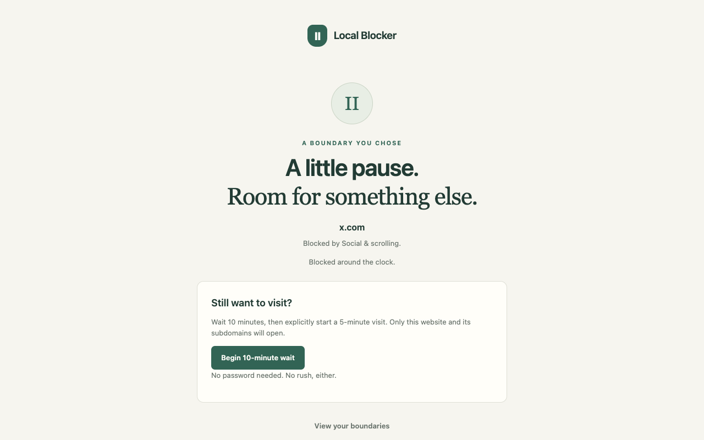

# Local Blocker

A small, private Chrome extension that gives distracting websites a schedule — and gives you a moment to reconsider before opening them.

**No account. No server. No analytics. No cloud sync.** The extension runs entirely in your Chrome profile, with no runtime dependencies.

[Download the local release](https://github.com/ajakubowski/local-blocker/releases/tag/v1.1.0) · [Privacy statement](PRIVACY.md) · [Report a bug](https://github.com/ajakubowski/local-blocker/issues)

The Chrome Web Store release is being prepared; the download currently installs through **Load unpacked**.

## Install locally

1. Keep the `extension` folder in a permanent location. If using the ready-to-load release ZIP, extract it and keep the extracted folder instead.
2. Open `chrome://extensions` in Chrome.
3. Enable **Developer mode**.
4. Click **Load unpacked** and choose the folder containing `manifest.json` (`extension` in this source project, or the extracted release folder).
5. Pin Local Blocker using Chrome’s extensions menu. Open it and choose **Open settings**.
6. Create a password, add a website group, choose its schedule, and review/save.
7. Grant access to the websites you add when Chrome asks. This enables the custom blocked page and replacement of already-open tabs. If you decline, basic network blocking still works; temporary visits are available from the popup.

Requires Chrome 120 or newer. No Web Store publishing, developer registration, Node installation, or build step is needed to use it. See [INSTALL.md](INSTALL.md) for updates and troubleshooting.

## How it works

- **Website groups:** Give Social, News, or Shopping their own always-blocked or weekly schedules. Multiple windows and overnight periods are supported.
- **Domains:** Enter a domain or paste a URL. Blocking covers that domain and its subdomains; paths are discarded. `x.com` does not match `notx.com`. Add `twitter.com` separately if desired.
- **Temporary visits:** By default, wait **10 minutes**, then explicitly start a **5-minute visit** to one website. You have five minutes to claim a ready visit. Only one request or visit can be active across the profile. A new visit requires a new wait.
- **No-exception groups:** Turn off “Allow temporary visits” for a group. The strictest active matching group wins, including stricter subdomains during a parent-domain visit.
- **Protected settings:** Unlock with your password for five minutes. Strengthening changes apply immediately. Weaker restrictions wait through the old cooldown, then require a fresh password entry after the wait to confirm the exact proposal. Editing the proposal restarts its wait.
- **Local backups:** Export saved groups and schedules to a file, then import them into another installation. Imports are reviewed and honor the existing cooldown. Passwords, visits, and pending changes are excluded.
- **Durable waits:** Waiting continues across closed pages, browser restart, and computer sleep. Ready windows and visits can expire while Chrome is closed. Restart never grants extra time.
- **Local time:** Schedules use the computer’s timezone. Start times are inclusive and end times exclusive. Overnight windows belong to their start day. Repeated daylight-saving minutes follow the same wall-clock rule; nonexistent minutes do not occur.
- **Incognito:** Manually enable **Allow in Incognito** in Chrome’s extension details. Blocking then uses the same settings. Visit requests and settings changes are managed in regular windows.

Preset waits: 5, 10, 15, 30, and 60 minutes. Custom waits accept 5–525,600 whole minutes; visits accept 1–1,440 minutes. Up to 100 groups, 500 distinct domains, and 64 time windows per group are supported.





## Privacy and limitations

The extension stores only configuration, a salted password verifier, and current pending changes/visits. It does not keep browsing history or blocked-attempt logs and does not transmit information. Read [PRIVACY.md](PRIVACY.md) for exact permissions and data handling.

This is a self-control aid, not a tamper-proof security boundary. You can still disable or uninstall it, edit its files or local storage, alter your clock, or use another profile/browser. A password protects the extension’s UI, not Chrome’s extension controls. Forgotten-password recovery requires removing and reinstalling the extension, which erases its settings.

Chrome can delay alarms, especially after startup or sleep. Rules and open tabs are reconciled at schedule boundaries, at least every 30 seconds while Chrome is able to run alarms, and on relevant browser events. Some cached pages can briefly appear before tab enforcement. Host access is necessary to replace existing tabs. Blocking is for HTTP(S) website navigation and embedded frames; it is not a system-wide network filter. Other apps, browser-internal pages, downloads, and unrelated domains used by the same service are outside its scope.

## Development

Use Node 24 or newer for the developer tools. Runtime code lives in `extension`; all dependencies are development-only.

```sh
npm ci
npm test
npm run check
PLAYWRIGHT_BROWSERS_PATH=.cache/ms-playwright npx playwright install chromium
npm run test:browser
npm run package
```

On Windows, set `PLAYWRIGHT_BROWSERS_PATH` to `.cache/ms-playwright` in your shell before the install command. The test runner sets this path automatically when it is not already set. Browser tests use isolated profiles and a local HTTP server, never your everyday browser profile.

Architecture and testing details: [docs/DEVELOPMENT.md](docs/DEVELOPMENT.md). Release validation: [docs/VALIDATION.md](docs/VALIDATION.md).

## Share it

`npm run package` creates a ready-to-load ZIP, a runtime-only Web Store upload ZIP, a source ZIP, and SHA-256 checksums in `dist`. The release has no personal settings or test passwords. Share the ZIP and installation instructions freely under the [MIT license](LICENSE).

The public source is maintained at [ajakubowski/local-blocker](https://github.com/ajakubowski/local-blocker). Contributions and bug reports are welcome; see [CONTRIBUTING.md](CONTRIBUTING.md).

Chrome Web Store submission is being prepared and is not yet published. The [launch kit](docs/store/LISTING.md) includes listing copy, privacy disclosures, reviewer instructions, and upload assets. Store distribution does not require adding analytics or a server.
